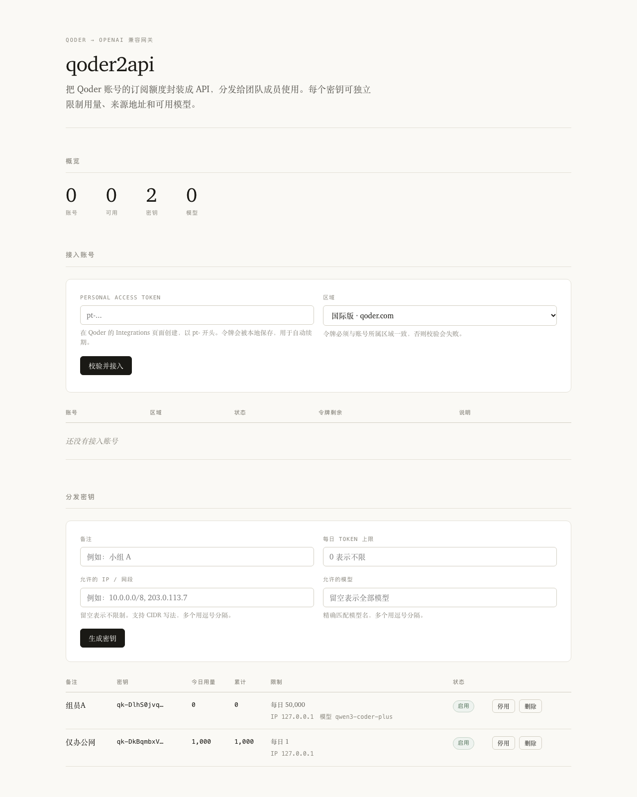

# qoder2api

把 Qoder 账号的订阅额度封装成 OpenAI 兼容 API，通过 API Key 分发给多人使用，每个密钥可以独立限制 token 用量、来源 IP 和可用模型。



## 为什么不用现成的

sub2api 不支持 Qoder 平台，它的平台常量里只有 Anthropic、OpenAI、Gemini、Antigravity、Grok、Kimi、智谱、DeepSeek、MiniMax 等，没有 Qoder。

`shuishuipingan/qoder2api-hub` 实现了完整协议，但它没有 IP 白名单（全仓搜索 `ip_whitelist` 零命中），限额也是账号级的而不是 Key 级的（5 个护栏键都挂在 `Account` 对象上，`key_id` 只用于用量归属）。这两个缺口正好是本项目的核心需求，加上它有 31.7k 行代码包含大量不需要的功能，所以本项目是精简重写。

## 功能

- 用 PAT 导入多个 Qoder 账号，国际版与国内版分别管理
- 账号池轮询，故障账号自动冷却，job token 到期自动续期
- 生成 API Key 分发给多人，每个 Key 独立配置
  - 每日 token 上限、总 token 上限
  - IP 白名单，支持 CIDR 网段
  - 模型白名单
- OpenAI 兼容的 `/v1/chat/completions`（支持流式）和 `/v1/models`
- 管理界面，Anthropic 风格排版与衬线体

## 部署

需要 Python 3.9 以上，没有第三方依赖。

```bash
git clone <本仓库>
cd qoder2api
Q2A_ADMIN_TOKEN=$(openssl rand -hex 24) Q2A_PORT=8791 python3 src/server.py
```

打开 `http://127.0.0.1:8791/?token=<你的管理令牌>` 进入管理界面。

### 环境变量

| 变量 | 默认值 | 说明 |
|---|---|---|
| `Q2A_HOST` | `127.0.0.1` | 监听地址 |
| `Q2A_PORT` | `8791` | 监听端口 |
| `Q2A_ADMIN_TOKEN` | 空 | 管理接口令牌。为空时只允许本机访问管理接口 |
| `Q2A_DATA` | `./data` | 数据库目录 |
| `Q2A_TRUST_FORWARDED` | `0` | 设为 `1` 时从 `X-Forwarded-For` 读取客户端 IP。**只有前面有可信反向代理时才打开**，否则 IP 白名单可被伪造绕过 |
| `Q2A_COSY_VERSION` | `1.1.75` | 签名版本号，Qoder 客户端升级后可能需要调整 |
| `Q2A_ACCESS_LOG` | `0` | 设为 `1` 打印访问日志 |

### 反向代理

服务默认只监听本机，对外暴露需要经过 nginx：

```nginx
server {
    listen 443 ssl http2;
    server_name api.example.com;

    ssl_certificate     /etc/letsencrypt/live/api.example.com/fullchain.pem;
    ssl_certificate_key /etc/letsencrypt/live/api.example.com/privkey.pem;

    client_max_body_size 64m;

    location / {
        proxy_pass http://127.0.0.1:8791;
        proxy_http_version 1.1;
        proxy_set_header Host              $host;
        proxy_set_header X-Real-IP         $remote_addr;
        proxy_set_header X-Forwarded-For   $proxy_add_x_forwarded_for;
        proxy_set_header X-Forwarded-Proto $scheme;

        # 流式响应必须关缓冲，否则客户端收不到逐字输出
        proxy_buffering off;
        proxy_cache off;
        proxy_read_timeout 3600s;
        proxy_send_timeout 3600s;
    }
}
```

启用反代后记得设置 `Q2A_TRUST_FORWARDED=1`，否则所有请求的来源 IP 都会显示为 127.0.0.1，IP 白名单会失效。

## 使用

### 接入账号

在 Qoder 的 Integrations 页面创建 Personal Access Token：

- 国际版 https://qoder.com/account/integrations
- 国内版 https://qoder.com.cn/account/integrations

令牌以 `pt-` 开头。粘贴到管理界面对应的区域下，点「校验并接入」。

PAT 本身是长期令牌，但它换来的 job token 只有 24 小时有效期，所以 PAT 会被本地保存用于自动续期。不要移除账号后到处散布 PAT。

### 分发给组员

在管理界面点「生成密钥」，按需填写限额、IP 网段和模型白名单。密钥只显示一次，生成后立即保存。

组员这样调用：

```bash
curl https://api.example.com/v1/chat/completions \
  -H "Authorization: Bearer qk-..." \
  -H "Content-Type: application/json" \
  -d '{"model":"Auto","messages":[{"role":"user","content":"你好"}]}'
```

在 pi、OpenAI SDK、各类客户端里填写同一个 base URL 和密钥即可。

模型名用 `/v1/models` 列出的 ID，例如 `Auto`、`Ultimate`、`kmodel_latest`、`dmodel`。

## 风险说明

这一节请认真读完再决定要不要分发给别人。

**协议是逆向后兼容的，不是官方接口。** 本项目复刻了 Qoder 客户端的 COSY 签名协议（AES-128-CBC 加密用户信息、RSA 加密对称密钥、MD5 计算签名）。理解这套协议的来源是官方扩展 `pi-provider-qoder` 的可执行代码和 `qoder2api-hub` 的实现，两者交叉验证过。它随时可能因为客户端升级而失效，届时需要更新签名版本号和实现。

**有被限制的风险。** 参考项目的风控文档给过三条硬约束，这里原样照搬：

1. 队列是模型级的，多账号不增加队列容量。
2. 数据中心 IP 无法用协议头伪装成住宅 IP。如果上游按 ASN 或地理做风控，唯一解是换出口，不是换头。
3. 设备身份是按账号派生的「稳定假设备」，能降低被判为爬虫的概率，但不等于官方客户端。

所以风险排序是：出口 > 身份 > 调度。把本项目部署在云服务器上（机房 IP）比家用宽带的暴露面更大。如果只是给身边几个人用，降低并发、限制每人每天的用量，比任何伪装都有效。

**共享账号席位本身可能违反服务条款。** 一个 Qoder 账号的订阅额度分给多人使用，和多人共用一个账号是同一种性质的行为。这一条不取决于本项目的实现方式。

## 与参考项目的差异

| 能力 | qoder2api-hub | 本项目 |
|---|---|---|
| IP 白名单 | 无 | 按 Key 配置，支持 CIDR |
| 限额粒度 | 账号级 | Key 级，日限额与总额 |
| 模型限制 | 全局 | 按 Key 配置 |
| 代码量 | 约 31.7k 行 | 约 1.5k 行 |
| 三方依赖 | 零 | 零 |
| Anthropic 协议 | 支持 | 不支持 |
| 签到与活动 | 支持 | 不支持 |
| Web 看板 | 支持 | 支持（精简） |

签到、活动领取这类功能本项目不做，它们和分发是两件事，且自动化签到本身也有风险。

## 开发

```bash
python3 -m unittest discover -s tests -v
```

代码结构：

```
src/cosy.py       COSY 签名、AES/RSA、自定义 Base64、设备指纹派生
src/qoder.py      与上游通信：PAT 交换、令牌刷新、模型列表、对话
src/store.py      SQLite：账号、Key、用量、设置
src/guard.py      访问控制：IP 白名单、模型白名单、配额
src/convert.py    SSE 信封拆包，转 OpenAI 格式
src/server.py     HTTP 服务与路由
web/index.html    管理界面
```

`CONTEXT.md` 记录了从源码提取的协议细节，包括端点、请求体结构、签名算法和已知的密码学弱点，改动协议相关代码前先读它。
